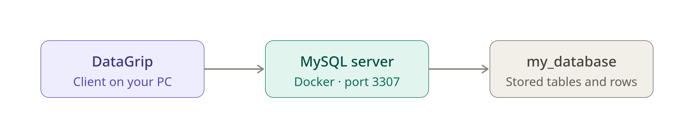

# DockerWebserverZBC
set up a local development environment with Docker that runs an Nginx server, PHP, and a MySQL database using **docker** to define and manage the different services. 

### 1. **Install Docker and Docker Compose**
make sure Docker is running properly
```
sudo systemctl status docker
```

### 2. **Create a Project Directory**
You’ll need a directory to hold the Docker setup and project files. Open up terminal (konsole, PowerShell, or Git Bash) and create a new directory for the project:

```bash
mkdir /home/reb/Documents/Code/DockerWebserverZBC
cd /home/reb/Documents/Code/DockerWebserverZBC
```

### 3. **Create `docker-compose.yml`**
This file will define the Nginx server, PHP service, and MySQL database. Inside  `/home/reb/Documents/Code/DockerWebserverZBC` directory, create a file named `docker-compose.yml`.

Here’s a basic configuration for the setup:

```yaml
version: '3.8'

services:
  nginx:
    image: nginx:latest
    container_name: nginx_container
    ports:
      - "8080:80"  # Exposes Nginx on port 8080 of your host machine
    volumes:
      - ./nginx/nginx.conf:/etc/nginx/nginx.conf  # Nginx config file
      - ./app:/var/www/html  # Your PHP application directory
    depends_on:
      - php
    networks:
      - mynetwork

  php:
    image: php:8.1-fpm
    container_name: php_container
    volumes:
      - ./app:/var/www/html  # The same app folder is shared with PHP
    networks:
      - mynetwork

  mysql:
    image: mysql:8.0
    container_name: mysql_container
    environment:
      MYSQL_ROOT_PASSWORD: root_password
      MYSQL_DATABASE: my_database
      MYSQL_USER: user
      MYSQL_PASSWORD: user_password
    volumes:
      - mysql_data:/var/lib/mysql
    ports:
      - "3306:3306"  # Exposes MySQL on port 3306 of your host machine
    networks:
      - mynetwork

networks:
  mynetwork:
    driver: bridge

volumes:
  mysql_data:
```
note: my system already has docker enabled inside of my configuration.nix file via 
```
virtualisation.docker.enable = true;
```
  Docker also reads and processes standard `docker-compose.yml` files natively.
  
###  Run the Compose file
Navigate to the folder containing the `docker-compose.yml` file in the terminal and start the containers:
```
docker compose up
```

Note: run `docker compose down` to turn off all containers

### Explanation:
- **nginx**: Runs an Nginx container and serves PHP from the `php-fpm` service.
- **php**: Runs PHP-FPM (FastCGI Process Manager), which allows Nginx to serve PHP files.
- **mysql**: Runs a MySQL container with environment variables to set the root password, a database, and user credentials.
- **volumes**: These map directories on your host machine to directories inside the container. This allows you to work with files on your host machine and have them available to Nginx and PHP. Note: save "states" can work here on this volume, otherwise my default, docker containers when restarted, have no saved files.

### 4. **Create Nginx Configuration**
You need to create an Nginx configuration file to tell Nginx how to handle PHP requests. Inside your project directory, create a folder called `nginx` and then a file named `nginx.conf`.

```bash
mkdir nginx
touch nginx/nginx.conf
```

Here’s a basic configuration to add to `nginx.conf`:

```nginx
worker_processes 1;

events { worker_connections 1024; }

http {
    server {
        listen 80;

        root /var/www/html;
        index index.php index.html;

        server_name localhost;

        location / {
            try_files $uri $uri/ =404;
        }

        location ~ \.php$ {
            include fastcgi_params;
            fastcgi_pass php:9000;
            fastcgi_index index.php;
            fastcgi_param SCRIPT_FILENAME $document_root$fastcgi_script_name;
        }

        location ~ /\.ht {
            deny all;
        }
    }
}
```

### 5. **Create the PHP Application Directory**
Now, you’ll set up the PHP application directory. In your project folder, create an `app` directory and a simple PHP file to test:

```bash
mkdir app
touch app/index.php
```

Add the following content to the `index.php` file to ensure PHP is working:
(Please note that you should never expose phpinfo() on a live server, as it will output environment variables.)

```php
<?php
phpinfo();
?>
```

### 6. **Run Docker Compose**
Now that everything is set up, it’s time to start the containers using Docker Compose. From your project directory, run:

```bash
docker-compose up -d
```
Note:
The program `docker-compose` is not in your PATH by default. You can make it available in an
ephemeral shell by typing:
 ```
 nix-shell -p docker-compose
 ```
This will:
- Pull the necessary images (`nginx`, `php-fpm`, and `mysql`).
- Create and start the containers.
- Run Nginx, PHP, and MySQL as separate services.

### 7. **Access the Web Server**
Once the containers are running, open your web browser and go to:

```
http://localhost:8080
```

You should see the **PHP info page**, which indicates that Nginx is correctly serving the PHP content.

### 8. **Connect to MySQL**
To connect to MySQL, you can use any MySQL client (e.g., MySQL Workbench, phpMyAdmin, or the command line) with the following credentials:

- **Host**: `localhost`
- **Port**: `3306`
- **User**: `user`
- **Password**: `user_password`
- **Database**: `my_database`

Note: on terminal, type the following:
```
docker exec -it mysql_container mysql -u user -puser_password my_database
```

### 9. **Stop the Services**
When you’re done and want to stop the containers, simply run:

```bash
docker-compose down
```

This will stop and remove the containers, but the volumes (like the MySQL data) will persist.

### Summary of Steps:
1. Install Docker.
2. Create a project directory.
3. Define services in `docker-compose.yml`.
4. Create Nginx configuration (`nginx.conf`).
5. Create a basic PHP application (`index.php`).
6. Start the services with Docker Compose.
7. Test the web server on `localhost:8080`.
8. Connect to MySQL via any MySQL client.
9. Stop the services with `docker-compose down`.

# Understand & Install
Hvad er et RDBMS, og hvordan etablerer jeg det?

## Launch the database server

Your teacher has handed over the Docker setup you need (I followed his GitHUb tutorial for the Docker setup for the assigment).

Start the MariaDB server.
Then check in Docker Desktop that the container is running. 
Note:  instead of docker desktop, just do:
```
docker ps -a
```

Find:

    Name of the container

    Which port number MariaDB uses

    What image the container uses

Based on the output from my `docker ps -a` command:

* **Name of the container:** `mysql_container`
* **Port number MariaDB/MySQL uses:** Inside the container, it uses standard port **`3306`** (mapped to host port **`3307`** on my machine)
* **Image the container uses:** `mysql:8.0`

MySQL and MariaDB are fully protocol-compatible and use the exact same default port (**`3306`**).

In my setup, the container is running the official **`mysql:8.0`** image, but from the application or database client's perspective, it speaks the exact same database protocol as MariaDB.

## Connect with MySQL Workbench
Note: in my use case scenario, i am using DataGrip by Jetbrains to do this part of the assigment.
Create a new connection in MySQL Workbench.

Use the information your teacher has given you.

When the connection works, drive:

`SELECT VERSION();`

### Examination

Which MariaDB version do you run?
`8.0.46`

### 3. Examine the server

Drive:

`SHOW DATABASES;`

What databases are on the server?
```
1 | information_schema
2 | my_database
3 | performance.schema
```

Then try:

`SELECT CURRENT_USER();`

Which user are you logged in as?
`user@%`

### 4. Think about the architecture

Answer the following:

    1. Is MySQL Workbench a database server?

    2. Is MySQL Workbench a database?

    3. Where does MariaDB run?

    4. What is the workbench connected to?

    5. What does Workbench send to MariaDB?
1. no
2. no
3. MariaDB runs as a background service on a server (can be setup in systemd to auto run at PC startup/boot, same way as you would run, for example, `watchdog` or a firewall in the background, same as daemons that run invisibly in the background),  your local machine, or inside a container, such as when using Docker)
4.  The workbench connects to a running database server instance (such as a MySQL or MariaDB database server running locally, remotely, or inside a Docker container).
5.  MySQL Workbench sends SQL queries, commands, and statements (such as SELECT, INSERT, UPDATE, or SHOW commands) over the network connection to the database server.

Then draw even a small figure that shows:

Workbench → MariaDB → Database
When you're done:


DataGrip is the client, the MySQL server runs in the Docker container, and my_database is the data that server manages.

Since i am using DataGrip, the connection settings are slightly different from the original assigment by the teacher, which says port 3306. In my `docker-compose.yml` the mapping is `"3307:3306"`, so from my machine i connect to `localhost` on port **3307**. Port 3306 is the port inside the container, which only other containers on `mynetwork` use. Also, the container runs `mysql:8.0`, not MariaDB. The two are protocol-compatible, so the client doesn't care, but the version i am running is MySQL 8.0.46.


You need to be able to explain the difference between:

    Database client, RDBMS/database server and database.

- **Database client**: the program you type queries into (DataGrip, Workbench). It holds no data itself. It only sends SQL and displays the results.
- **RDBMS / database server**: the running software (MySQL here) that accepts connections, parses and executes SQL, and manages access and storage. It's the process listening on port 3307.
- **Database**: the organized collection of data, here `my_database`. It's what the server stores and manages, and it lives in the `mysql_data` volume.
